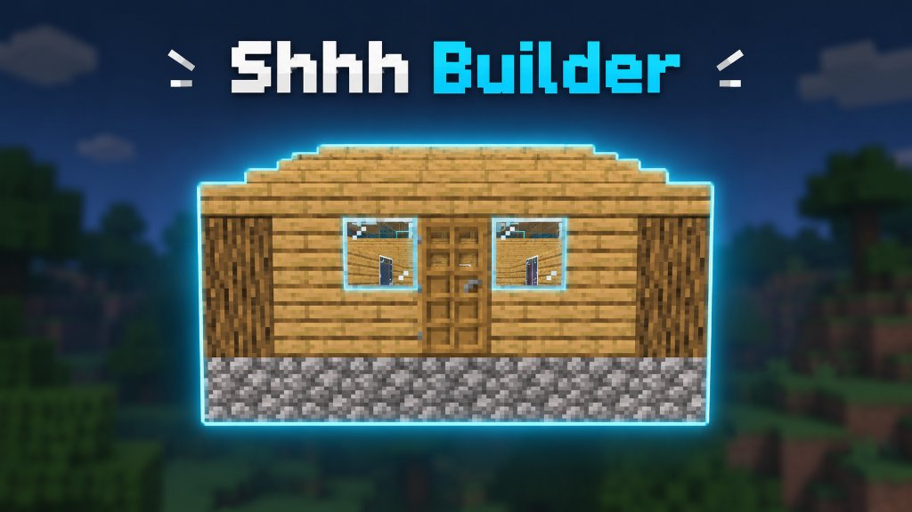
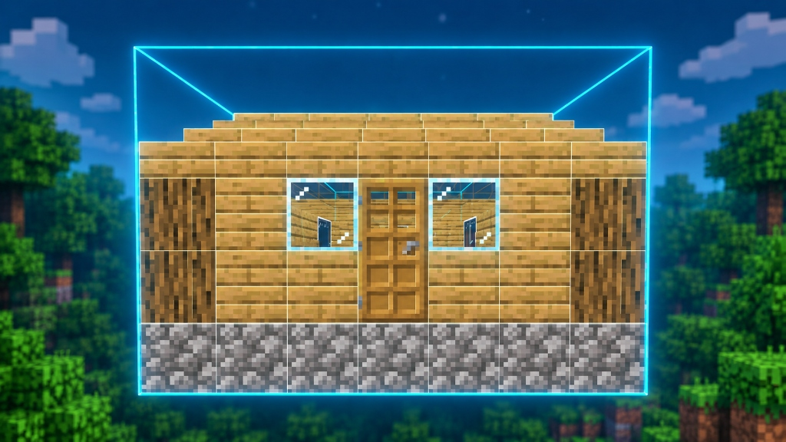
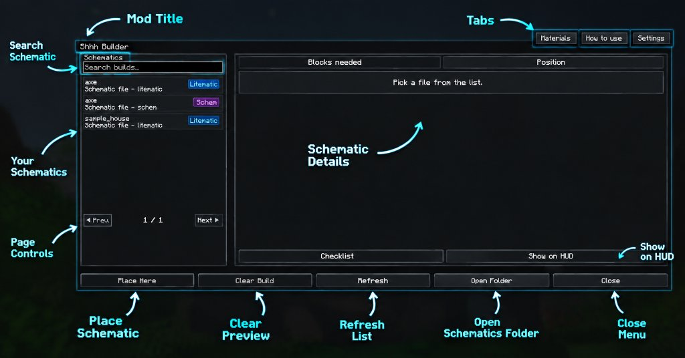
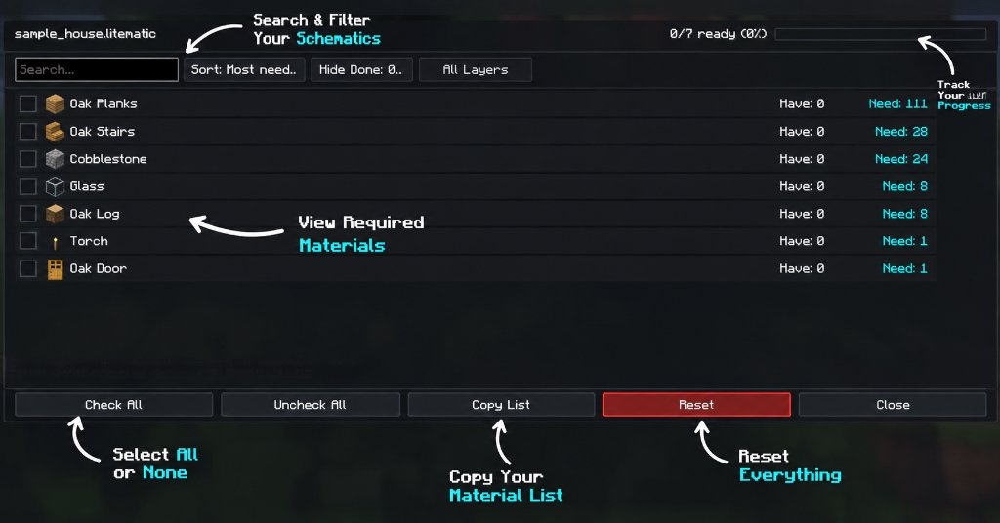
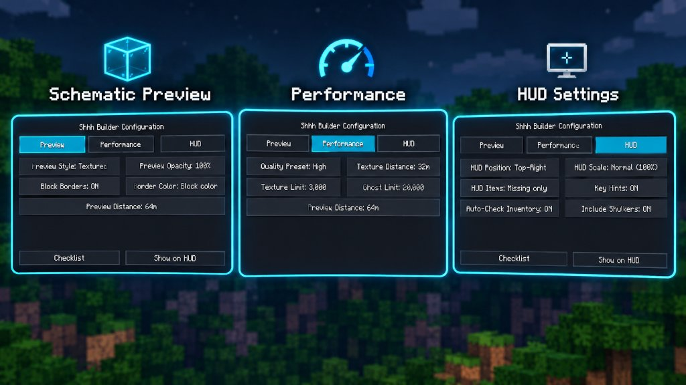
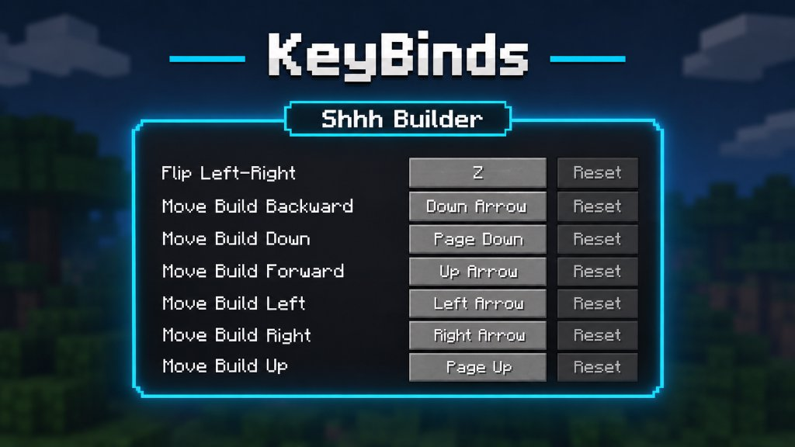
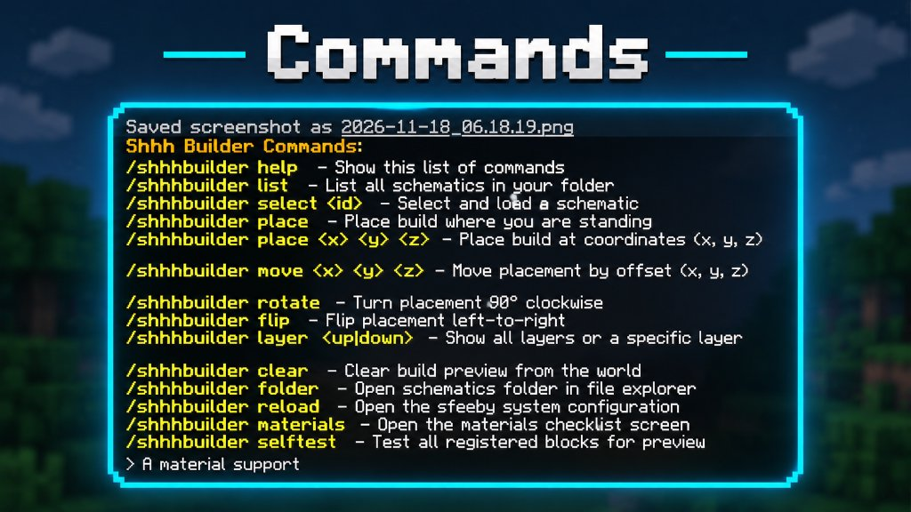

# Shhh Builder

**A sleek, beginner-friendly schematic viewer and holographic building assistant for Minecraft Fabric.**  
*Zero mixins • Zero bytecode injection • 100% fair-play compliant*

---

## Overview

Tired of clunky, overly complex schematic tools with endless sub-menus? **Shhh Builder** brings modern UI design, simplicity, and performance to building from schematics in Minecraft.

Simply place your `.litematic` or `.schem` files into `.minecraft/schematics/`, press **`V`**, and start building with translucent 3D holographic ghost blocks guiding your way.

---

## ✨ Key Features

### 1. In-World Hologram Previews
- **Textured Ghost Blocks**: View translucent (~45% opacity default, adjustable 10%–100%) see-through blocks with full models and textures right where you want to build.
- **6-Neighbor Face Culling**: Fully occluded interior blocks are skipped from rendering so mega-schematics never drop your framerate.
- **Fail-Safe Circuit Breaker**: If an experimental shader or resource pack causes a render glitch, Shhh Builder gracefully falls back to crisp wireframes without crashing your game.

---

### 2. Main Schematic Browser (`V`)
Filter, browse, and place your builds with an intuitive split-pane interface designed for all resolutions and GUI scales.

- **Search Filtering**: Filter schematics instantly as you type in the search box.
- **Format Badges**: Clear badges for `.litematic` and `.schem` files.
- **Quick Controls**: Place at your feet, clear preview, refresh list, or open your schematics folder in one click.

---

### 3. Interactive Materials Checklist (`K`)
Track all required materials with live inventory scanning, shulker box counting, and automatic placed-block deductions.

- **Live Inventory Scanner**: Compares needed materials against your inventory in real time.
- **Shulker Box Awareness**: Optionally counts items stored inside shulker boxes in your inventory.
- **Stack & Shulker Math**: See quantities broken down by exact block count, stacks, and full shulkers.
- **Dynamic Deductions**: As you place correct blocks into the world, missing item counts decrease automatically.
- **One-Click Export**: Click **[Copy List]** to copy a clean shopping list directly to your clipboard.

---

### 4. Grouped Settings & Performance Presets
Configure preview appearance, performance limits, and HUD overlays to match your playstyle and PC specs.

- **Preview**: Adjust preview opacity, block border outlines, and border colors.
- **Performance**: 1-click quality presets (Low, Balanced, High) and distance limits.
- **HUD Settings**: Customize position, scale, and toggle item auto-checking.

---

### 5. Customizable Keybinds

All keybindings can be customized in **Options → Controls → Key Binds → Shhh Builder**:

| Key | Default Action | Description |
| :---: | :--- | :--- |
| **`V`** | Open Main Screen | Browse schematics, view details, search files, and place builds |
| **`K`** | Materials Checklist | Open full interactive materials manager & inventory comparison |
| **`H`** | Toggle Material HUD | Toggle the compact materials overlay on your screen |
| **`B`** | Toggle Bounding Box | Show or hide the cyan 3D bounding box around the placement |
| **`G`** | Toggle Ghost Blocks | Quickly toggle hologram/wireframe preview visibility |
| **`R`** | Rotate 90° | Rotate active placement 90 degrees clockwise |
| **`Z`** | Flip / Mirror | Mirror active placement horizontally |
| **`M`** | Cycle Layer Mode | Switch between All Layers, Single Layer, and Up To |
| **`[` / `]`** | Layer Down / Up | Move the active layer slice down or up |
| **`\`** | Reset to All Layers | Instantly reset layer filtering back to show all blocks |
| **Arrow Keys** | Nudge N / S / W / E | Shift schematic position by 1 block in the cardinal directions |
| **PgUp / PgDn** | Nudge Up / Down | Shift schematic vertically by 1 block |

---

### 6. Client-Side Commands (`/shhhbuilder`)

Shhh Builder provides a complete set of client-side chat commands that operate with zero server communication. You can control builds entirely from chat:

| Command | Description |
| :--- | :--- |
| `/shhhbuilder help` | Display list of all client commands and usage examples |
| `/shhhbuilder tutorial` | Open the interactive 7-step step-by-step tutorial card |
| `/shhhbuilder materials` | Open the Materials Checklist screen (alias `/shhhbuilder checklist`) |
| `/shhhbuilder list` | List all `.litematic` and `.schem` files in your schematics folder |
| `/shhhbuilder select <file>` | Select and load a schematic with tab-completion |
| `/shhhbuilder place` | Place the selected build right where you are standing |
| `/shhhbuilder place <x> <y> <z>` | Place the selected build at exact coordinates |
| `/shhhbuilder move <x> <y> <z>` | Move placement by relative offsets (dx, dy, dz) |
| `/shhhbuilder rotate` | Turn placement 90° clockwise |
| `/shhhbuilder flip` | Flip placement left-to-right |
| `/shhhbuilder layer <all\|number>` | Switch layer mode to all or isolate a specific layer |
| `/shhhbuilder clear` | Clear build preview from the world |
| `/shhhbuilder folder` | Open schematics folder in your file explorer |

---

## 📥 Installation

1. Install **Fabric Loader** (`0.20.1` or newer) for **Minecraft 26.3**.
2. Install **Fabric API** for 26.3.
3. Download **`shhh-builder-1.0.0.jar`** and place it in your `.minecraft/mods` folder.
4. *(Optional)* Install **Mod Menu** to view and edit settings from the in-game mod list.
5. Launch Minecraft! A starter sample house schematic will be deployed automatically to your `.minecraft/schematics/` folder to get you started immediately.

---

## 🛡️ Server Compliance & Fair Play

Shhh Builder runs entirely on your local game client:
- Transmits **zero custom network packets** to servers.
- Contains **no automated block-placing (no printer/botting)**.
- Functions purely as a visual reference guide and hotbar slot helper.
- 100% safe and compliant on vanilla, survival, and competitive multiplayer servers.

---

## 📄 License & Source

Licensed under the permissive [MIT License](LICENSE).  
Source code and issue tracker are hosted on [GitHub](https://github.com/rafayshhh/shhh-builder).
